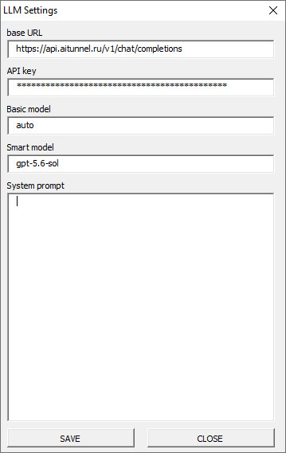
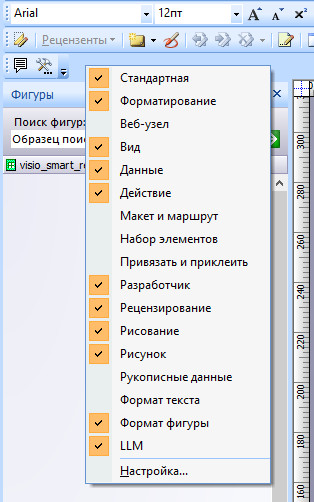
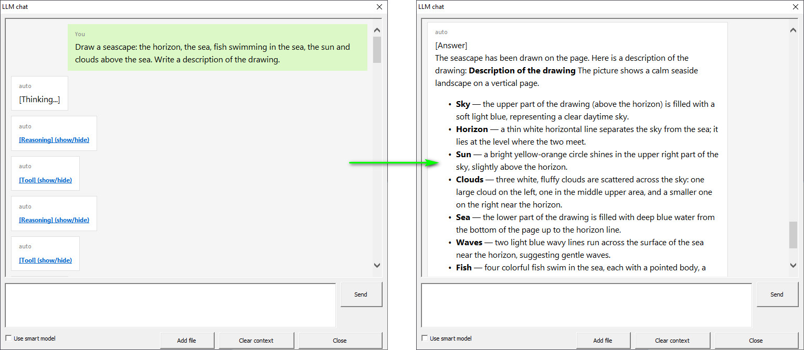
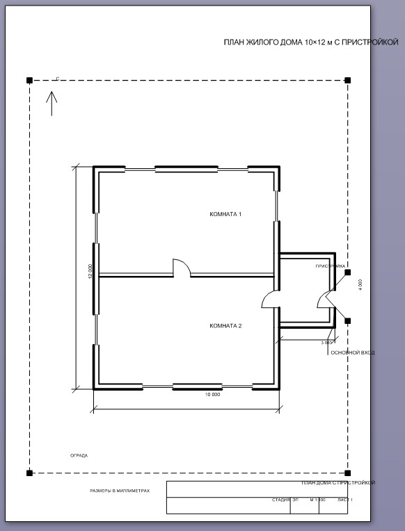
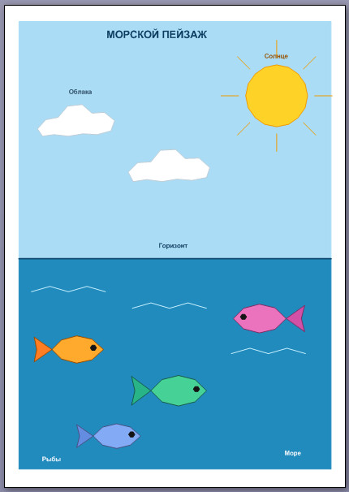

[English](README.md) | **Русский**

# Visio Smart Redactor

**Visio Smart Redactor** — это трафарет (stencil) Microsoft Visio, который интегрирует LLM-агента непосредственно в среду Visio. Агент может читать и изменять диаграммы: рисовать фигуры, редактировать текст, форматировать ячейки, работать с файлами — всё через естественный язык в встроенном чате.

Проект построен на базе библиотеки [VBA-Harness](https://github.com/Obsidian-pb/vba_harness) и использует [VBA-JSON](https://github.com/VBA-tools/VBA-JSON) для работы с JSON.

---

## Содержание

- [Возможности](#возможности)
- [Архитектура](#архитектура)
- [Инструменты агента (Tools)](#инструменты-агента-tools)
- [Установка](#установка)
- [Настройка](#настройка)
- [Использование](#использование)
- [Структура проекта](#структура-проекта)
- [Разработка собственных инструментов](#разработка-собственных-инструментов)
- [Зависимости](#зависимости)
- [Лицензия](#лицензия)

---

## Возможности

- **Чат с LLM внутри Visio** — встроенное окно чата на базе HTML-рендера (WebBrowser control) с поддержкой reasoning, tool-calling и индикатора работы.
- **Tool calling (function calling)** — агент автоматически вызывает инструменты для взаимодействия с документом Visio и файловой системой.
- **Многоходовый агентский цикл** — агент может последовательно вызывать несколько инструментов, прежде чем дать финальный ответ (до 30 ходов по умолчанию).
- **Контекст документа (RAG)** — содержимое текстовых файлов можно добавить в контекст LLM как справочный материал.
- **Переключение моделей** — выбор между «умной» и «быстрой» моделью прямо в чате.
- **Настройки в реестре Windows** — URL API, ключ, модели и system prompt сохраняются в `HKCU\Software\LLMVisio\`.
- **Совместимость с 32/64-bit Office** — объявления Win32 API адаптированы под обе разрядности.

---

## Архитектура

Проект следует паттерну **Harness** — единого класса-оркестратора, который управляет циклом общения с LLM:

```
Пользователь → LLM_chat_html (форма чата)
                    ↓
              clsHarness (агентский цикл)
                    ↓
         HTTP-запрос к LLM API (OpenAI-compatible)
                    ↓
         Парсинг ответа (tool_calls / content / reasoning)
                    ↓
      clsHarnessToolsHandler → диспетчер инструментов
                    ↓
        clsTool_* (конкретные инструменты Visio)
                    ↓
         Результат возвращается в историю сообщений
                    ↓
            Цикл повторяется, пока LLM не даст
            финальный текстовый ответ
```

### Ключевые компоненты

| Компонент | Назначение |
|---|---|
| `clsHarness` | Главный класс агента: хранит историю сообщений, отправляет HTTP-запросы к LLM, парсит ответы, управляет циклом tool-calling. |
| `clsHarnessToolsHandler` | Реестр инструментов: регистрирует все `clsTool_*`, генерирует JSON-схему `tools[]` для отправки LLM, диспетчеризует вызовы по имени. |
| `clsToolBase` | Абстрактный базовый класс для всех инструментов. Каждый инструмент реализует свойства `Name`, `Description`, `Schema` и метод `Execute`. |
| `clsTool_*` | Конкретные инструменты для работы с Visio и файлами (см. [ниже](#инструменты-агента-tools)). |
| `LLM_chat_html` | Главная форма чата. Отображает сообщения через встроенный WebBrowser, обрабатывает события агента (`OnAnswer`, `OnReasoning`, `OnToolCalling`, `OnThinking`, `OnTick`). |
| `LLM_config` | Форма настроек LLM (URL, модель, API-ключ, system prompt). |
| `m_toolbar` / `c_buttons` | Создание панели инструментов «LLM» в Visio и обработка нажатий кнопок. |
| `m_json` | Утилиты для работы с JSON на базе `JsonConverter` из VBA-JSON. |
| `m_FileIO` | Чтение/запись файлов в UTF-8, разрешение путей, создание папок. |
| `m_Constants` | Глобальные константы (режим отладки, ключи реестра, значения по умолчанию). |
| `m_Utils` | Логирование, чтение/запись настроек реестра. |
| `m_TextTransform` | Добавление секции Text Transform к фигурам Visio. |
| `t_Shapes` | Утилиты для работы с ячейками фигур Visio (чтение, запись, проверка существования). |
| `m_DiceRoll` | Утилита генерации случайных чисел (вспомогательный модуль). |

### Агентский цикл

1. Пользователь вводит запрос в чат.
2. Запрос добавляется в историю сообщений с ролью `user`.
3. История (включая system prompt и описания инструментов) отправляется в LLM API.
4. Если LLM возвращает `tool_calls` — каждый вызов выполняется соответствующим инструментом, результат добавляется в историю с ролью `tool`, и цикл повторяется.
5. Если LLM возвращает текстовый ответ без `tool_calls` — это финальный ответ, цикл завершается.
6. Лимит ходов (по умолчанию 30) защищает от бесконечных циклов.

---

## Инструменты агента (Tools)

Агенту доступны следующие инструменты для манипуляции документом Visio:

| Имя инструмента | Описание |
|---|---|
| `get_page_size` | Возвращает ширину и высоту активной страницы в дюймах. |
| `get_shapes_list` | Возвращает список всех фигур на активной странице с их ID и типом (полигон / линия). |
| `draw_poly_line` | Рисует ломаную линию (или полигон, если первая и последняя точки совпадают). Параметры: координаты точек, толщина линии, цвет линии, цвет заливки. |
| `draw_text_box` | Создаёт текстовую фигуру (надпись) по координатам прямоугольника. Параметры: координаты углов, текст, угол поворота. |
| `set_format_shape` | Пакетно устанавливает значения произвольных ячеек Visio-фигуры. Формат: `CELL1:value1;CELL2:value2;...` |
| `read_shape_cells` | Читает значения указанных ячеек фигуры. Возвращает пары `ИмяЯчейки:Значение`. |
| `read_shape_text` | Читает текст (надпись) указанной фигуры. |
| `set_shape_text` | Устанавливает текст (надпись) для указанной фигуры. |
| `read_text_file` | Читает текстовый файл (UTF-8) по абсолютному или относительному пути. |
| `write_text_file` | Записывает текст в файл (UTF-8). Создаёт недостающие папки, перезаписывает существующий файл. |

---

## Установка

### Требования

- Microsoft Visio (2007 или новее)
- Доступ к OpenAI-совместимому API (например, [aitunnel.ru](https://aitunnel.ru), OpenAI, DeepSeek и др.)

### Шаги

1. Скопируйте файл `visio_smart_redactor.vss` в папку трафаретов Visio (обычно `Documents\Мои фигуры\`).
2. Откройте Visio и перетащите фигуру из трафарета на страницу документа — это активирует код проекта.
3. На панели инструментов Visio появится панель **«LLM»** с двумя кнопками:
   - **Chat** — открыть окно чата с агентом.
   - **Settings** — открыть настройки LLM.

> При закрытии документа панель инструментов автоматически удаляется.

---

## Настройка

Нажмите кнопку **Settings** на панели «LLM» или откройте форму `LLM_config` из редактора VBA.



### Параметры

| Параметр | Описание | Значение по умолчанию |
|---|---|---|
| **API URL** | URL эндпоинта OpenAI-совместимого API | `https://api.aitunnel.ru/v1/chat/completions` |
| **Model (main)** | Идентификатор основной («умной») модели | `deepseek-v4-pro` |
| **Model (fast)** | Идентификатор быстрой модели | `deepseek-v4-flash` |
| **API Key** | Ключ авторизации для API | *(пусто)* |
| **System Prompt** | Системный промпт, задающий поведение агента | *(пусто)* |

Настройки сохраняются в реестре Windows по пути:

```
HKEY_CURRENT_USER\Software\LLMVisio\
```

> **Важно:** API-ключ хранится в реестре в открытом виде. Убедитесь, что у вас достаточно прав доступа к системе.

---

## Использование

1. **Откройте чат** — нажмите кнопку **Chat** на панели «LLM».



2. **Выберите модель** — в окне чата переключатель позволяет выбрать основную или быструю модель.
3. **Введите запрос** — например:
   - «Нарисуй прямоугольник 5×3 см в центре страницы»
   - «Покажи список всех фигур на странице»
   - «Измени текст фигуры с ID 3 на "Привет, мир!"»
   - «Прочитай файл notes.txt и сделай по нему диаграмму»



4. **Добавьте файл в контекст** — кнопка добавления файла позволяет загрузить текстовый файл (`.txt`, `.md`, `.qmd`) в контекст LLM (RAG). Содержимое файла добавляется в историю сообщений с ролью `system`.
5. **Очистить контекст** — кнопка очистки сбрасывает историю сообщений и заново инициализирует агента.

### Визуализация в чате

- **Сообщения пользователя** — зелёные пузыри справа.
- **Ответы агента** — белые пузыри слева.
- **Reasoning (рассуждения)** — сворачиваемый блок `[Reasoning]`.
- **Результаты инструментов** — сворачиваемый блок `[Tool]`.
- **Индикатор работы** — вращающийся символ в заголовке окна во время ожидания ответа LLM.

---

## Структура проекта

```
visio_redactor_agent/
├── visio_smart_redactor.vss      # Файл трафарета Visio (содержит весь код проекта)
├── LICENSE                       # MIT License
├── README.md                     # README (English)
├── README.ru.md                  # README (Русский)
└── code/                         # Исходный код VBA (экспортированные модули)
    ├── ThisDocument.bas          # Обработчики открытия/закрытия документа
    ├── m_Constants.bas           # Глобальные константы
    ├── m_toolbar.bas             # Создание/удаление панели инструментов
    ├── c_buttons.cls             # Обработка нажатий кнопок панели
    ├── clsHarness.cls            # Главный класс агента (цикл, HTTP, парсинг)
    ├── clsHarnessToolsHandler.cls # Реестр и диспетчер инструментов
    ├── clsToolBase.cls           # Абстрактный базовый класс инструментов
    ├── clsTool_PageSize.cls      # Инструмент: размер страницы
    ├── clsTool_ShapesList.cls    # Инструмент: список фигур
    ├── clsTool_DrawPolyLine.cls  # Инструмент: рисование ломаной/полигона
    ├── clsTool_DrawTextBox.cls   # Инструмент: создание текстовой надписи
    ├── clsTool_FormatShape.cls   # Инструмент: форматирование ячеек фигуры
    ├── clsTool_ReadShapeCells.cls # Инструмент: чтение ячеек фигуры
    ├── clsTool_ReadShapeText.cls # Инструмент: чтение текста фигуры
    ├── clsTool_SetShapeText.cls  # Инструмент: установка текста фигуры
    ├── clsTool_ReadTextFile.cls  # Инструмент: чтение текстового файла
    ├── clsTool_WriteTextFile.cls # Инструмент: запись текстового файла
    ├── LLM_chat_html.frm/.frx    # Форма чата
    ├── LLM_config.frm/.frx       # Форма настроек
    ├── m_json.bas                # Утилиты JSON (на базе VBA-JSON)
    ├── m_FileIO.bas              # Файловые операции (UTF-8)
    ├── m_Utils.bas               # Утилиты (логирование, реестр)
    ├── m_TextTransform.bas       # Секция Text Transform для фигур
    ├── m_DiceRoll.bas            # Генератор случайных чисел
    ├── t_Shapes.bas              # Утилиты работы с ячейками Visio
    └── JsonConverter.bas         # Модуль VBA-JSON (сторонняя библиотека)
```

---

## Примеры получаемых результатов



**LLM**: GPT 5.6 sol. **Prompt**: *Нарисуй чертеж дома состоящего из двух комнат и пристройки. Нарисуй двери и окна, укажи основной вход. Оформи как чертеж*.



**LLM**: GPT 5.6 sol. **Prompt**: *Draw a seascape: the horizon, the sea, fish swimming in the sea, the sun and clouds above the sea. Write a description of the drawing.*

---

## Разработка собственных инструментов

Проект использует паттерн **Tool** на базе абстрактного класса `clsToolBase`. Каждый инструмент — это отдельный модуль класса, реализующий интерфейс `clsToolBase`. Чтобы добавить новый инструмент, выполните три шага.

### Шаг 1. Создайте класс инструмента

Создайте новый модуль класса (например, `clsTool_MyTool.cls`) и добавьте `Implements clsToolBase`. Нужно переопределить четыре члена:

| Член | Тип | Назначение |
|---|---|---|
| `clsToolBase_Name` | `Property Get` | Имя инструмента, которое видит LLM в `tools[]`. Должно быть уникальным. |
| `clsToolBase_Description` | `Property Get` | Описание для LLM: когда и зачем вызывать этот инструмент. От качества описания зависит, насколько корректно агент будет выбирать инструмент. |
| `clsToolBase_Schema` | `Property Get` | JSON Schema параметров в виде строки. Определяет, какие аргументы LLM передаст инструменту. |
| `clsToolBase_Execute` | `Function` | Основная логика. Принимает строку JSON с аргументами, возвращает строку JSON с результатом. |

### Шаг 2. Реализуйте логику

```vb
Option Explicit
Implements clsToolBase

' Имя инструмента — то, что LLM видит в tools[]
Private Property Get clsToolBase_Name() As String
    clsToolBase_Name = "my_tool"
End Property

' Описание для LLM: когда и зачем вызывать
Private Property Get clsToolBase_Description() As String
    clsToolBase_Description = "Делает что-то полезное. " & _
        "Вызывайте этот инструмент, когда пользователь просит ..."
End Property

' JSON Schema параметров
Private Property Get clsToolBase_Schema() As String
    clsToolBase_Schema = "{" & _
        """type"":""object""," & _
        """properties":{" & _
            """param1"":{""type"":""string"",""description"":""Описание параметра""}" & _
        "}," & _
        """required"":['"param1"']" & _
    "}"
End Property

' Выполнение инструмента
Private Function clsToolBase_Execute(ByVal argsJson As String) As String
    On Error GoTo ErrHandler

    ' Извлечение аргументов из JSON
    Dim param1 As String
    param1 = ExtractJsonString(argsJson, "param1")

    ' ... логика инструмента ...

    ' Возврат результата в формате JSON
    clsToolBase_Execute = "{""status"":""ok"",""message"":""Готово""}"
    Exit Function

ErrHandler:
    clsToolBase_Execute = "{""status"":""error"",""message"":""" & Err.Description & """}"
End Function
```

### Рекомендации

- **Извлечение аргументов.** Используйте функцию `ExtractJsonString(json, key)` из модуля `m_json` — она рекурсивно ищет ключ в JSON и возвращает значение в виде строки.
- **Экранирование строк в результате.** Если возвращаемое сообщение содержит кавычки, переводы строк или обратные слэши, используйте `JsonString(s)` из модуля `m_json` для экранирования. Для типовых ответов удобно использовать готовые функции `MakeOk(msg)` и `MakeError(msg)`.
- **Формат результата.** Возвращайте JSON-объект с полями `status` (`"ok"` или `"error"`) и `message` — агент и LLM ожидают этот формат.
- **Обработка ошибок.** Всегда используйте `On Error GoTo ErrHandler`, чтобы при сбое инструмент вернул понятное сообщение об ошибке, а не «положил» агентский цикл.
- **Описание для LLM.** Пишите описание так, чтобы LLM понимала, в каких ситуациях вызывать инструмент. Указывайте единицы измерения, форматы данных и значения по умолчанию.
- **Вспомогательные модули.** Доступны: `t_Shapes` (работа с ячейками фигур), `m_FileIO` (файлы UTF-8), `m_TextTransform` (секция Text Transform), `m_Utils` (логирование, реестр).

### Шаг 3. Зарегистрируйте инструмент

Добавьте регистрацию в методе `Init()` класса `clsHarnessToolsHandler`:

```vb
Public Sub Init()
    Set tools = New Collection

    ' ... существующие инструменты ...

    ' Ваш новый инструмент
    Dim toolInstance As clsToolBase
    Set toolInstance = New clsTool_MyTool
    tools.Add toolInstance, toolInstance.name

End Sub
```

После этого инструмент автоматически:
- попадёт в JSON-схему `tools[]`, отправляемую LLM;
- будет доступен для вызова по имени через диспетчер `Execute`;
- получит аргументы от LLM и вернёт результат в историю сообщений.

---

## Зависимости

| Зависимость | Назначение | Источник |
|---|---|---|
| [VBA-Harness](https://github.com/Obsidian-pb/vba_harness) | Базовая архитектура LLM-агента (clsHarness, clsHarnessToolsHandler, clsToolBase) | Включена в проект |
| [VBA-JSON](https://github.com/VBA-tools/VBA-JSON) | Парсинг и сериализация JSON (`JsonConverter`) | Включена в проект (`JsonConverter.bas`) |
| MSXML2.ServerXMLHTTP | HTTP-запросы к LLM API | Встроен в Windows |
| ADODB.Stream | Чтение/запись файлов в UTF-8 | Встроен в Windows |
| Microsoft.Scripting.Runtime | Работа с объектом Dictionary | Встроен в Office |
| Scripting.FileSystemObject | Файловые операции | Встроен в Windows |
| WebBrowser Control | Отображение чата на HTML | Встроен в Office |

---

## Лицензия

Проект распространяется под лицензией **MIT**. См. файл [LICENSE](LICENSE).

Copyright © 2026 Obsidian-pb